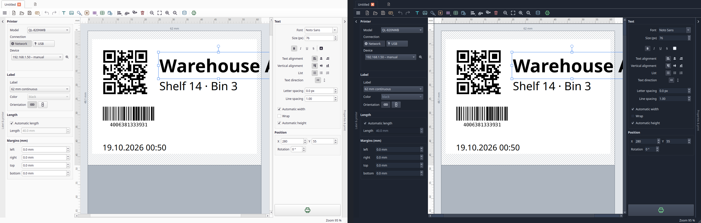
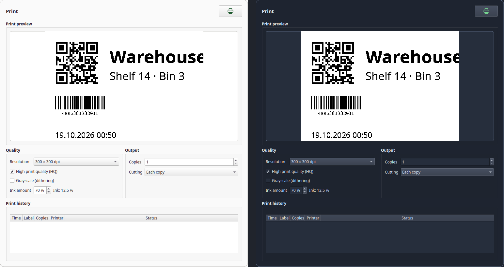

# QLInux

**A native Linux label editor for Brother QL printers — a P-touch Editor
clone, in Python.**




QLInux designs labels on a real canvas (text, images, barcodes, QR codes),
shows an exact monochrome print preview and prints straight to the printer —
over the network (`tcp://…:9100`) or USB. No browser, no WebUSB, no vendor
driver.

## Supported printers

**Every model the [`brother_ql`](https://github.com/pklaus/brother_ql) library
supports** — QLInux hard-codes no model. Label sizes (currently 23 types), DPI
and cutter support all come from that library:

> QL-500, QL-550, QL-560, QL-570, QL-580N, QL-650TD, QL-700, QL-710W, QL-720NW,
> QL-800, QL-810W, QL-820NWB, QL-1050, QL-1060N

The model list even appears in the app: *menu → About QLInux*.

## Features

- **Canvas**: text, images, barcodes, QR codes, lines, shapes, tables,
  date/time stamps and clip art. The usual editing: move, scale, rotate,
  align, reorder, undo and redo.
- **Database (CSV)**: connect a CSV file in the bottom database panel and drag a
  column onto a text, barcode or QR code (or onto an empty spot for a new bound
  text). The value comes from the current record; select another row in the grid
  to change it. The inspector's *Database field* changes the bound column. The
  merged values stay on the label if the CSV is later disconnected or missing.
  With a CSV connected, print can use the selected row, every row, or a
  from–to range. Copies repeat each of those labels.
- **Label media**: pick tape by model, fixed or automatic length (always the
  total length, including margins), orientation across/along the tape, red
  printing where supported.
- **Print**: the toolbar button opens a sheet with the 1-bit preview, quality
  and output options, copies, cutting, and the session history. Printing
  starts from the button in that sheet.
- **Avery Zweckform sheets**: the print target *Label sheet* lays the same
  design onto an A4 sheet, using the gLabels Zweckform templates. The canvas
  becomes one label of that product. With a CSV connected, the selected rows,
  every row, or a from–to range fill the grid, one record per label; copies
  repeat a record in the next cells. The first label skips fields already
  used on a partial sheet. Save a PDF or send it to a normal printer at actual
  size. A millimetre offset nudges the whole sheet when the printer does not
  start at the paper edge.
- **Printer**: network or USB. Printers are found with mDNS and SNMP, USB
  devices show up in the list, and the last one is selected again when it
  is still there. *Detect label* reads the tape over USB. The network port
  has no read-back, but QLInux asks the printer over SNMP. It warns before
  sending to a printer with a fault (open cover, wrong tape) and marks a job
  red in the session history if the printer reports one after it. After a
  clean job it remembers the loaded tape and asks before printing a
  different one.
- **Preview** in real print dots, plus a 1:1 overlay on the canvas
  (Ctrl+Shift+P).
- **Templates**: seven ready-made labels plus your own stored as `.qlx`
  files.
- **German and English UI** (switch at runtime). Appearance follows the
  system, or stays light or dark. Dialogs open as sheets in the main window.



## Requirements

- Linux with a desktop (X11 or Wayland), Python ≥ 3.10
- A Brother QL printer, reachable over the network or via USB
- Everything else is pinned in `requirements.txt`

## Install

**Ready to run (AppImage):** download the latest build for your machine from
[Releases](https://github.com/loeffelandi/QLInux/releases/latest)
(≈ 68 MB, the Qt runtime is included), make it executable and start it — no
installation, no root:

```bash
# x86_64
chmod +x QLInux-*-x86_64.AppImage
./QLInux-*-x86_64.AppImage

# aarch64 (64-bit ARM: Raspberry Pi OS 64-bit, Ubuntu/Debian arm64, …)
chmod +x QLInux-*-aarch64.AppImage
./QLInux-*-aarch64.AppImage
```

The aarch64 AppImage needs **glibc 2.39 or newer** (Ubuntu 24.04, Debian 13 /
Raspberry Pi OS Trixie). Older systems such as Raspberry Pi OS Bookworm do not
start it.

**From source:**

```bash
git clone https://github.com/loeffelandi/QLInux.git
cd QLInux
bash scripts/bootstrap_venv.sh     # creates .venv, installs pinned deps,
                                   # applies the Pillow-10 patch to brother_ql
.venv/bin/python -m ql_editor
```

Releases carry a **single-file AppImage** per architecture — build it yourself
with one command (no installation, no root). A `.deb` is deliberately not
planned: PySide6 and `python-barcode` are not in the distribution archives, so
a package would have to carry the whole Qt runtime anyway; the AppImage does
exactly that, just without root.

## AppImage

```bash
bash packaging/build_appimage.sh      # builds dist/QLInux-<version>-<arch>.AppImage
./dist/QLInux-*-$(uname -m | sed 's/arm64/aarch64/').AppImage
```

The script takes the architecture from the build machine (`x86_64` or
`aarch64`). A published GitHub release builds both files in
[`.github/workflows/appimage.yml`](.github/workflows/appimage.yml) and attaches
them together.

The build uses PyInstaller (`requirements-dev.txt`) and fetches `appimagetool`
once into `packaging/.cache/` (not in the repository). What is bundled: the
application plus its Python dependencies, including the Qt runtime and the XCB
helpers Qt needs to open a window. Those helpers must be installed on the
**build** machine (e.g. `libxcb-cursor0`); otherwise PyInstaller omits them and
the AppImage exits without a GUI. Excluded is what the app never uses —
QtWebEngine, QML/Quick, Multimedia, SQL, Charts — otherwise the file would be
several hundred megabytes larger.

The icon comes from `packaging/make_icon.py`, the desktop entry from
`packaging/ql-editor.desktop`: both are plain files in the repository, not
generated blobs. Settings still live in `~/.config/QLInux/QLInux.conf`, so an
AppImage and a source checkout share them.

## Getting started

1. Start QLInux. In the *Printer* panel pick **Network** or **USB**.
2. Press the **magnifier** next to the device list — network printers are
   found via mDNS and SNMP; a single device is selected automatically. Only if
   nothing is found: *“Add by IP address…”* as the last entry of the list.
3. Select the tape, type your text, drop in images, barcodes or QR codes.
4. Open **Print**, check the preview and options, then print from the sheet.

Settings (last printer, tape, print options, language, appearance) are stored in
`~/.config/QLInux/QLInux.conf`.

### Modifier keys on the canvas

| Keys | Effect |
| --- | --- |
| Ctrl + mouse wheel (Cmd on macOS), pinch | Zoom |
| Shift + mouse wheel | Scroll horizontally |
| Ctrl + click | Add or remove an object from the selection |
| Ctrl + drag | Duplicate the selected object and move the copy |
| Shift + arrow keys | Move the selected object in larger steps |
| Shift + click in a table | Extend the cell selection |
| Tab / Shift + Tab in a table | Next or previous cell while typing |
| Ctrl + click in the database grid | Add or remove a row; the last row stays selected |
| Shift + click in the database grid | Select a range of rows |
| Rotating without Shift | Stick to the nearest 90° until the pointer moves clearly away |
| Shift while rotating | Rotate in 15° steps |

### Database grid

The canvas previews the first selected row. **Print** with *Selected records*
prints every selected row.

### Ruler guides

Drag down from the top ruler for a horizontal guide, or right from the left
ruler for a vertical one. Drag a guide back onto that ruler to remove it.
Guides stay on the label and are stored in the `.qlx` file. Moving or resizing
an object snaps to these guides as well as to the label and to other objects.
**Align to guides** uses the same targets.

## Margins

Margins start at 0 mm. The printer's feed and the non-printable strip at each
edge of the tape are already included automatically, so they are not margins.

- **Left and top** move the objects when you change them; they keep their distance
  to the edge, and the dotted frame moves with them.
- **Bottom** sets the tape length when the length is automatic.
- **Right** cuts off everything beyond it, also across the tape, where it does not
  change the tape width. Along the tape it also sets the length.

Content that lies beyond a margin is hatched on the canvas and is neither shown in
the preview nor printed.

## Saving and opening labels

*File → Open…* (Ctrl+O) and *File → Save* (Ctrl+S). The arrow next to the save button in the toolbar opens *Save as…* (Ctrl+Shift+S)
store a label as a `.qlx` file — plain JSON, so it stays readable, diffable
and diff-friendly in a repository.

A document carries the label medium (model, tape, orientation, length,
margins, colour), the canvas objects and any ruler guides. It deliberately does **not** carry
your printer address, print options or window size: those belong to the
machine, so opening a label from somebody else never changes your printer.
The window title shows the file name, with a `*` while there are unsaved
changes.

### Double-clicking label files

The AppImage declares both `.qlx` (QLInux label, own icon) and `.lbx` (Brother
P-touch label) as its file types. Double-clicking such a file starts QLInux and
opens it. To make QLInux the default app, pick it under *Open with* in your file
manager, or from a terminal:

```
xdg-mime default ql-editor.desktop application/x-qlinux-label
xdg-mime default ql-editor.desktop application/x-brother-lbx
```

A file opened from the file manager always gets its own tab. If QLInux is
already running, the file opens as a new tab in that window and the window comes
to the front. Starting QLInux again with no file does the same focus and the
second process exits, instead of opening another window. On Wayland the
compositor may ignore that raise, so the running window is not always focused.
Only when QLInux is not running yet does a new window start; the
empty starting label is then replaced by the file, unless you already changed it.

### Opening a Brother `.lbx` file

*File → Open…* also accepts P-touch Editor files (`.lbx`). QLInux reads the
tape, the orientation and the objects, then treats the result as a new unsaved
label — *Save* asks for a `.qlx`, it does not write back into the `.lbx`.

What comes across: text (one font per box; horizontal alignment; rotation in
90° steps stays inside the box), images (resampled from the embedded bitmap
down to the label size), lines and frames. Text inside a cable template comes
across too; the template itself does not. Text is not shrunk to fit the way
P-touch does it. Rotation in the file is counter-clockwise (checked against
P-touch Editor on a vertical logo). Database text fields come across as bound
text. QLInux opens the CSV at the path stored in the `.lbx` when that path
points at a file, and otherwise looks for a CSV next to the `.lbx`. If neither
can be read, the last merged text stays on the label. What does not: barcodes, tables, date/time fields, image cropping,
and red ink on two-colour tapes. Those are listed in a note after import. Mixed-style runs inside one text box
keep the box's base font, and Brother's monochrome image settings (threshold,
dither) are not copied — the print dialog has its own.

### USB permissions

Reading the inserted tape (and the printer status) over USB needs write access
to the device node. QLInux offers **“Set up access”** in the *Printer* panel
when it is missing; it installs a udev rule with `TAG+="uaccess"`
(`scripts/install-udev-rule.sh` → `/etc/udev/rules.d/70-brother-ql.rules`).
The network port (TCP 9100) needs no permissions — but it has no read-back,
so *Detect label* only works over USB. The SNMP check (UDP 161, community
`public`) needs no permissions either. It only runs if the printer answered
SNMP before the job; with SNMP switched off, jobs are reported as sent. If the
printer goes silent after a job, the history says “Sent, no status reply”.

## Development

```bash
bash scripts/bootstrap_venv.sh
.venv/bin/pip install -r requirements-dev.txt
QT_QPA_PLATFORM=offscreen .venv/bin/python -m pytest -q      # headless test suite
python scripts/verify_api.py            # documents the real brother_ql API
```

The same suite runs on every push and pull request
([`.github/workflows/tests.yml`](.github/workflows/tests.yml), Python 3.12 on
Ubuntu x86_64 and aarch64).

The tests run headless: `tests/conftest.py` forces the Qt *offscreen* platform
and redirects `XDG_CONFIG_HOME` to a temporary directory, so a test run never
opens a window and never touches your settings. How to add a test without
making that suite slow again is in [docs/tests.md](docs/tests.md).

Architecture and every measured printer detail (raster commands, cut commands,
600 dpi mode, USB permissions) are documented in
[docs/API_NOTES.md](docs/API_NOTES.md).

## Templates

*Menu → Templates* has ready-made labels — address label, parcel label, cable,
folder spine, price tag, WiFi QR, inventory. They all use 62 mm endless tape
with automatic length, so they fit on any endless tape; the printer model is
deliberately not part of a template (that is the printer's business). The
sample texts come in the interface language.

*Save as template…* stores the current label in
`~/.config/QLInux/templates/` — as a `.qlx` file, the same format *Save* uses.
That means a template is an ordinary label file: you can copy, mail or edit it.
Your own templates then appear in the same menu.

## Status

| Milestone | Content | Status |
| --- | --- | --- |
| M1 | Setup, API verification, data model | ✅ |
| M2 | Rendering core + print wrapper (headless) | ✅ |
| M3 | PySide6 GUI (canvas, panel, preview) | ✅ |
| M3.11–M3.13 | Collapsible panels, print quality, resolution per model, USB support | ✅ |
| M3.14–M3.16 | Printer selection without addresses, USB permissions (udev), German/English UI | ✅ |
| M3.17–M3.19 | Rulers, network printer discovery (mDNS + SNMP) | ✅ |
| M3.20–M3.21 | IP entry behind a list entry, copies and cutting | ✅ |
| M4.1 | Labels as files: open, save, save as (`.qlx`), unsaved-changes marker | ✅ |
| M4.2 | Templates (built-in and your own) | ✅ |
| M4.3 | Packaging: AppImage (PyInstaller + appimagetool) | ✅ |
| M4.4 | Open Brother P-touch files (`.lbx`, import only) | ✅ |
| Database | CSV source, field bindings, record preview, LBX database import | ✅ |
| Database | Database panel, drag-and-drop binding, database field in the inspector | ✅ |
| Database | Print the selected row, all rows, or a record range | ✅ |
| Database | Numbering on one object | ✅ |

## License

QLInux is released under the **GNU General Public License, version 3 or later
(GPL-3.0-or-later)** — see [LICENSE](LICENSE). This is required by its core
dependency: `brother_ql` is GPL-3.0-or-later.

## Thanks to

| Library | Author | License | Used for |
| --- | --- | --- | --- |
| [brother_ql](https://github.com/pklaus/brother_ql) | Philipp Klaus | GPL-3.0-or-later | printer commands, tape and model sizes |
| [Qt for Python (PySide6)](https://pyside.org) | The Qt Company | LGPL-3.0 | user interface (windows, canvas, sheets) |
| [Pillow](https://python-pillow.org) | Fredrik Lundh and contributors | MIT-CMU | rendering and raster data |
| [pyusb](https://github.com/pyusb/pyusb) | Wander Lairson Costa and contributors | BSD-3-Clause | USB connection |
| [qrcode](https://github.com/lincolnloop/python-qrcode) | Lincoln Loop and contributors | BSD-3-Clause | QR codes |
| [python-barcode](https://github.com/WhyNotHugo/python-barcode) | Thorsten Weimann and contributors | MIT | barcodes |
| [gLabels](https://github.com/jimevins/glabels-qt) | Jim Evins and contributors | GPL-3.0-or-later | Avery Zweckform sheet measurements |

## Disclaimer

QLInux is not affiliated with Brother Industries, Ltd. or Avery Zweckform.
“Brother” and “P-touch” are trademarks of Brother Industries, Ltd. “Avery”
and “Zweckform” are trademarks of their owners. Use at your own risk —
printing wrong labels is your printer's fault only in the most literal sense.

## Developed by

**Sustain – Andreas Schäfer** · [www.sustain-vt.de](https://www.sustain-vt.de)

Bug reports and pull requests are welcome:
<https://github.com/loeffelandi/QLInux/issues>
