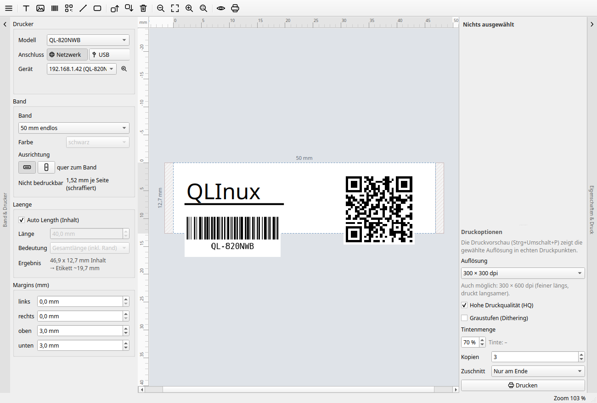
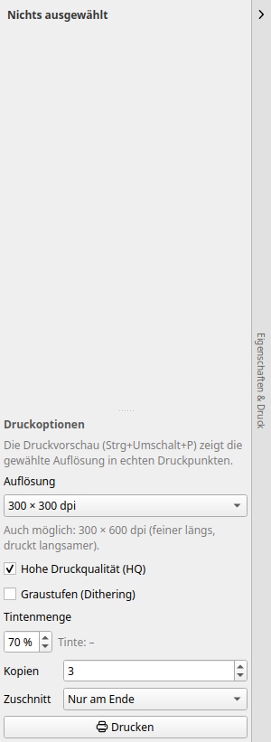

# QLInux

**A native Linux label editor for Brother QL printers — a P-touch Editor
clone, in Python.**




QLInux designs labels on a real canvas (text, images, barcodes, QR codes),
shows an exact monochrome print preview and prints straight to the printer —
over the network (`tcp://…:9100`) or USB. No browser, no WebUSB, no vendor
driver.

## Supported printers

**Every model the [`brother_ql`](https://github.com/pklaus/brother_ql) library
supports** — QLInux hard-codes no model. Label sizes (currently 23 types), DPI
and cutter support all come from that library:

> QL-500, QL-550, QL-560, QL-570, QL-580N, QL-650TD, QL-700, QL-710W, QL-720NW,
> QL-800, QL-810W, QL-820NWB, QL-1050, QL-1060N

The model list even appears in the app: *menu → About QLInux*.

## Features

- **Canvas**: text (double-click to edit), images, barcodes, QR codes, lines
  and rectangles; move, scale, rotate, align (to the margin frame or to the
  selection), undo/redo.
- **Label media**: pick tape by model, fixed or automatic length, margins,
  orientation across/along the tape, red printing where supported.
- **Print**: 300 × 300 or 300 × 600 dpi, high quality mode, grayscale
  (dithering), ink amount, **1–99 copies per job** and
  **cutting** — after each copy, only at the end, or not at all.
- **Printer selection without knowing addresses**: switches for network/USB,
  discovery of network printers (mDNS + SNMP) and USB devices; *Detect label*
  reads the inserted tape (USB only — the network port has no read-back).
- **Preview** in real print dots, plus a print preview mode at 1:1 (Ctrl+Shift+P).
- **Templates**: seven ready-made labels plus your own stored as `.qlx`
  files.
- **German and English UI** (switch at runtime), macOS-like sheets instead of
  extra windows.



## Requirements

- Linux with a desktop (X11 or Wayland), Python ≥ 3.10
- A Brother QL printer, reachable over the network or via USB
- Everything else is pinned in `requirements.txt`

## Install

**Ready to run (AppImage):** download the latest
[`QLInux-*.x86_64.AppImage`](https://github.com/loeffelandi/QLInux/releases/latest)
(≈ 68 MB, the Qt runtime is included), make it executable and start it — no
installation, no root:

```bash
chmod +x QLInux-*-x86_64.AppImage
./QLInux-*-x86_64.AppImage
```

**From source:**

```bash
git clone https://github.com/loeffelandi/QLInux.git
cd QLInux
bash scripts/bootstrap_venv.sh     # creates .venv, installs pinned deps,
                                   # applies the Pillow-10 patch to brother_ql
.venv/bin/python -m ql_editor
```

Releases carry a **single-file AppImage** — build it yourself with one command
(no installation, no root). A `.deb` is deliberately not planned: PySide6 and
`python-barcode` are not in the distribution archives, so a package would have
to carry the whole Qt runtime anyway; the AppImage does exactly that, just
without root.

## AppImage

```bash
bash packaging/build_appimage.sh      # builds dist/QLInux-<version>-x86_64.AppImage
./dist/QLInux-*-x86_64.AppImage       # start it
```

The build uses PyInstaller (`requirements-dev.txt`) and fetches `appimagetool`
once into `packaging/.cache/` (not in the repository). What is bundled: the
application plus its Python dependencies, including the Qt runtime. Excluded is
what the app never uses — QtWebEngine, QML/Quick, Multimedia, SQL, Charts —
otherwise the file would be several hundred megabytes larger.

The icon comes from `packaging/make_icon.py`, the desktop entry from
`packaging/ql-editor.desktop`: both are plain files in the repository, not
generated blobs. Settings still live in `~/.config/QLInux/QLInux.conf`, so an
AppImage and a source checkout share them.

## Getting started

1. Start QLInux. In the *Printer* panel pick **Network** or **USB**.
2. Press the **magnifier** next to the device list — network printers are
   found via mDNS and SNMP; a single device is selected automatically. Only if
   nothing is found: *“Add by IP address…”* as the last entry of the list.
3. Select the tape, type your text, drop in images, barcodes or QR codes.
4. Check the preview, then press **Print**.

Settings (last printer, tape, print options, language) are stored in
`~/.config/QLInux/QLInux.conf`.

## Margins

Margins start at 0 mm. The printer's feed and the non-printable strip at each
edge of the tape are already included automatically, so they are not margins.

- **Left and top** move the objects when you change them; they keep their distance
  to the edge, and the dotted frame moves with them.
- **Bottom** sets the tape length when the length is automatic.
- **Right** cuts off everything beyond it, also across the tape, where it does not
  change the tape width. Along the tape it also sets the length.

Content that lies beyond a margin is hatched on the canvas and is neither shown in
the preview nor printed.

## Saving and opening labels

*File → Open…* (Ctrl+O) and *File → Save* (Ctrl+S, *Save as…* Ctrl+Shift+S)
store a label as a `.qlx` file — plain JSON, so it stays readable, diffable
and diff-friendly in a repository.

A document carries the label medium (model, tape, orientation, length,
margins, colour) and the canvas objects. It deliberately does **not** carry
your printer address, print options or window size: those belong to the
machine, so opening a label from somebody else never changes your printer.
The window title shows the file name, with a `*` while there are unsaved
changes.

### Opening a Brother `.lbx` file

*File → Open…* also accepts P-touch Editor files (`.lbx`). QLInux reads the
tape, the orientation and the objects, then treats the result as a new unsaved
label — *Save* asks for a `.qlx`, it does not write back into the `.lbx`.

What comes across: text (one font per box; horizontal alignment; rotation in
90° steps stays inside the box), images (resampled from the embedded bitmap
down to the label size), lines and frames. Text is not shrunk to fit the way
P-touch does it. What does not: barcodes, tables, database fields, date/time
fields and cable templates. Those are listed in a note after import. Mixed-style
runs inside one text box keep the box's base font, and Brother's monochrome
image settings (threshold, dither) are not copied — the print dialog has its
own.

### USB permissions

Reading the inserted tape (and the printer status) over USB needs write access
to the device node. QLInux offers **“Set up access”** in the *Printer* panel
when it is missing; it installs a udev rule with `TAG+="uaccess"`
(`scripts/install-udev-rule.sh` → `/etc/udev/rules.d/70-brother-ql.rules`).
The network port (TCP 9100) needs no permissions — but it has no read-back,
so *Detect label* only works over USB.

## Development

```bash
bash scripts/bootstrap_venv.sh
.venv/bin/pip install -r requirements-dev.txt
QT_QPA_PLATFORM=offscreen .venv/bin/python -m pytest -q      # headless test suite
python scripts/verify_api.py            # documents the real brother_ql API
```

The same suite runs on every push and pull request
([`.github/workflows/tests.yml`](.github/workflows/tests.yml), Python 3.12 on Ubuntu).

The tests run headless: `tests/conftest.py` forces the Qt *offscreen* platform
and redirects `XDG_CONFIG_HOME` to a temporary directory, so a test run never
opens a window and never touches your settings.

Architecture and every measured printer detail (raster commands, cut commands,
600 dpi mode, USB permissions) are documented in
[docs/API_NOTES.md](docs/API_NOTES.md).

## Templates

*Menu → Templates* has ready-made labels — address label, parcel label, cable,
folder spine, price tag, WiFi QR, inventory. They all use 62 mm endless tape
with automatic length, so they fit on any endless tape; the printer model is
deliberately not part of a template (that is the printer's business). The
sample texts come in the interface language.

*Save as template…* stores the current label in
`~/.config/QLInux/templates/` — as a `.qlx` file, the same format *Save* uses.
That means a template is an ordinary label file: you can copy, mail or edit it.
Your own templates then appear in the same menu.

## Status

| Milestone | Content | Status |
| --- | --- | --- |
| M1 | Setup, API verification, data model | ✅ |
| M2 | Rendering core + print wrapper (headless) | ✅ |
| M3 | PySide6 GUI (canvas, panel, preview) | ✅ |
| M3.11–M3.13 | Collapsible panels, print quality, resolution per model, USB support | ✅ |
| M3.14–M3.16 | Printer selection without addresses, USB permissions (udev), German/English UI | ✅ |
| M3.17–M3.19 | Rulers, network printer discovery (mDNS + SNMP) | ✅ |
| M3.20–M3.21 | IP entry behind a list entry, copies and cutting | ✅ |
| M4.1 | Labels as files: open, save, save as (`.qlx`), unsaved-changes marker | ✅ |
| M4.2 | Templates (built-in and your own) | ✅ |
| M4.3 | Packaging: AppImage (PyInstaller + appimagetool) | ✅ |
| M4.4 | Open Brother P-touch files (`.lbx`, import only) | ✅ |

## License

QLInux is released under the **GNU General Public License, version 3 or later
(GPL-3.0-or-later)** — see [LICENSE](LICENSE). This is required by its core
dependency: `brother_ql` is GPL-3.0-or-later.

## Thanks to

| Library | Author | License | Used for |
| --- | --- | --- | --- |
| [brother_ql](https://github.com/pklaus/brother_ql) | Philipp Klaus | GPL-3.0-or-later | printer commands, tape and model sizes |
| [Qt for Python (PySide6)](https://pyside.org) | The Qt Company | LGPL-3.0 | user interface (windows, canvas, sheets) |
| [Pillow](https://python-pillow.org) | Fredrik Lundh and contributors | MIT-CMU | rendering and raster data |
| [pyusb](https://github.com/pyusb/pyusb) | Wander Lairson Costa and contributors | BSD-3-Clause | USB connection |
| [qrcode](https://github.com/lincolnloop/python-qrcode) | Lincoln Loop and contributors | BSD-3-Clause | QR codes |
| [python-barcode](https://github.com/WhyNotHugo/python-barcode) | Thorsten Weimann and contributors | MIT | barcodes |

## Disclaimer

QLInux is not affiliated with Brother Industries, Ltd. “Brother” and
“P-touch” are trademarks of Brother Industries, Ltd. Use at your own risk —
printing wrong labels is your printer's fault only in the most literal sense.

## Developed by

**Sustain – Andreas Schäfer** · [www.sustain-vt.de](https://www.sustain-vt.de)

Bug reports and pull requests are welcome:
<https://github.com/loeffelandi/QLInux/issues>
